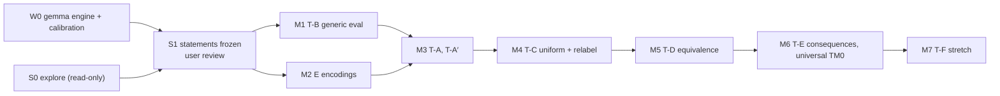

# MISSION DIRECTIVE (TM→Partrec): Turing machines are computed by partial recursive functions

**Purpose.** Formalize, carefully and independently, that the evaluation of a Turing machine is a partial recursive function
(the "machines ⇒ recursive functions" half of the Church–Turing equivalence), uniformly in the machine. This is foundational,
and it is the prerequisite for Track B (B2, universal machine) of `MISSION_DIRECTIVE_CMPP.md`, which is **blocked until this mission lands**.

Toolchain: Lean `v4.36.0`, Mathlib pinned to the **same commit** as S4TuringPoisson
(`fc4f59e577feb1a4956671bc04ac18aaaf8cd842`, from `S4TuringPoisson/lake-manifest.json`), so the result can later be `require`d by S4TP and TauCeti-based projects without conflicts.
Standing rules from `.agents/rules/lean-integrity.md` apply (zero `sorry`/`axiom`, junk-value vigilance, isolated worktrees, 24 GB RAM guardrails, 5-retry escalation).

---

## 0. The gap (verified against the pinned Mathlib, 21 Nov 2026)

| Mathlib / TauCeti file | What it gives | What it does not give |
|---|---|---|
| `Computability/TuringMachine/ToPartrec.lean`, `Config.lean` | **Partrec ⇒ TM**: a `TM2` machine evaluating `ToPartrec.Code` (`PartrecToTM2.tr_eval`) | the converse |
| `Computability/TuringMachine/Computable.lean` | `TM2Computable`, `TM2ComputableInPolyTime` (complexity-oriented definitions) | any link to `Partrec` |
| `PostTuringMachine.lean`, `StackTuringMachine.lean`, `Tape.lean` | TM0/TM1/TM2 semantics, translations `TM1to0.tr_eval`, `TM2to1.tr_eval`, `TM0.Machine.map`, `Machine.map_step`, `Machine.map_respects` | `Primcodable` instances for `ListBlank`, `Tape`, `Cfg`; any `Primrec`/`Partrec` statement |
| `StateTransition.lean` | `Turing.eval`, `mem_eval`, `Reaches`, `reaches_eval` | partrec-ness of `Turing.eval` |
| `PartrecCode.lean`, `Halting.lean`, `Partrec.lean`, `Primrec/*` | `Code.eval`, `exists_code`, `curry`/`eval_curry`, `halting_problem`, `Partrec.rfind`, `Primrec.nat_iterate`, `Primrec.dom_finite`, `Primcodable.ofEquiv`, `Primcodable.subtype`, list primrec lemmas | — (these are our tools) |
| TauCeti `Computability/*` | degrees, priority methods, primrec lists | nothing on Turing machines |

S4TP already has a related but **non-general** result: `universalHaltingTM0` (M3.2) translates one fixed Mathlib Partrec program into a TM0 (the *easy* direction), and `FinTM0.reaches_iff_exists_iterate_stepOpt` (a reusable lemma).

---

## 1. Headline results

Notation: `Γ Λ : Type` (Mathlib's `Primcodable` lives in `Type`), `[Inhabited Γ]` with `default` = blank.

| ID | Statement (sketch; final names fixed at gate S1) | Role |
|---|---|---|
| **T-B (generic)** | `theorem Turing.eval_partrec [Primcodable σ] {f : σ → Option σ} (hf : Computable f) : Partrec (Turing.eval f)` | The core: any computable step function has partrec evaluation (search for the halting time with `Nat.rfind` over iterates) |
| **E (encodings)** | `ListBlank.trim : ListBlank Γ → List Γ` (canonical: strip trailing blanks) with `mk_trim`, `trim_mk`, `trim_injective`; `Primcodable` instances on `ListBlank Γ` (via the subtype of trimmed lists), `Tape Γ`, `TM0.Stmt Γ`, `TM0.Cfg Γ Λ`; primrec of `ListBlank.head/tail/cons/nth`, `Tape.move/write/mk₁/mk₂/nth` | Makes Mathlib's own types computable objects |
| **T-A (fixed machine)** | `TM0.step_primrec (M) : Primrec (TM0.step M)`; **`TM0.eval_partrec (M) : Partrec (TM0.eval M)`**; `TM0.evalCfg_partrec (M) : Partrec (Turing.eval (TM0.step M))` (arbitrary start tapes, needed by `HaltsWithWindow`) under `[Finite Γ] [Finite Λ] [DecidableEq Γ] [DecidableEq Λ] [Primcodable Γ] [Primcodable Λ]` | "every TM0 is computed by a partrec function", stated on **Mathlib's `TM0.eval` itself** |
| **T-A′ (Nat level)** | `∃ c : Nat.Partrec.Code, ∀ l, c.eval (encode l) = (TM0.eval M l).map encode` | The literal "computed by a recursive function" in Kleene's sense |
| **T-C (uniform)** | `TM0Code` (primcodable machine descriptions over `ℕ` symbols/states, out-of-range ⇒ halt, blank `0`), `TM0Code.machine : TM0Code → TM0.Machine ℕ ℕ`; `TM0Code.step_primrec : Primrec₂ (fun m c ↦ TM0.step m.machine c)`; **`TM0Code.eval_partrec : Partrec₂ (fun m c ↦ Turing.eval (TM0.step m.machine) c)`**; relabeling theorem: every finite TM0 `M` has a code `m` and injective pointed relabelings `f : PointedMap Γ ℕ`, `g : Λ → ℕ` with `Turing.eval (step m.machine) (c.map f g) = (Turing.eval (step M) c).map (·.map f g)` (via `Machine.map_step`) | The machine is data: one partrec interpreter for all machines |
| **T-D (equivalence)** | For `f : ℕ →. ℕ`: `Nat.Partrec f ↔ ∃ M : TM0 machine with finite types, ∀ n, TM0.eval M (enc n) = (f n).map (ListBlank.mk ∘ enc)` for a **fixed, named** encoding `enc` (decision Q3). (⇒) via Mathlib's `PartrecToTM2.tr_eval`, `TM2to1.tr_eval`, `TM1to0.tr_eval` + finite supports; (⇐) via T-A | Formal Church–Turing equivalence for TM0 |
| **T-E (consequences)** | (1) `REPred` and `¬ ComputablePred` for TM0 halting over `TM0Code × List ℕ` (via T-C, T-D, Mathlib `halting_problem`); (2) computable map `TM0Code → Nat.Partrec.Code` (s-m-n via `Code.curry`); (3) **universal TM0**: one finite `U` and primrec `enc`/`dec` with `(TM0.eval U (enc (m, c))).map dec = Turing.eval (TM0.step m.machine) c`, plus a **windowed** variant (halts with the final tape's window `[-k,k]` readable) | (3) is exactly what CMPP B2 consumes |
| **T-F (stretch)** | `TM1.eval`, `TM2.eval` partrec for machines with finite supports (via the translations; state sets of translated machines are infinite but finitely supported) | Completeness of the picture |

Additional required results are anti-vacuity witnesses (§6 G5).

---

## 2. Design decisions and points requiring care

1. **Faithfulness.** All theorems are about Mathlib's `Turing.TM0.step`, `TM0.eval`, `Turing.eval`. No re-implemented semantics in any headline statement. Raw list-based steppers are allowed only as internal tools with a proved simulation lemma `abs ∘ rawStep = Option.map abs ∘ TM0.step ∘ abs`.
2. **Quotients.** `ListBlank` is a quotient (lists modulo trailing blanks). The canonical form `trim` is the only way to compute on it; every primrec lemma about `ListBlank` must factor through `trim` and be proved well-defined. Getting this wrong silently breaks injectivity of encodings.
3. **Instances.** The `Primcodable (ListBlank Γ)`, `Tape`, `Cfg` instances are **scoped** (namespace `TuringRecursive`) to avoid future diamonds if Mathlib adds its own; include a round-trip test `decode (encode x) = some x`.
4. **Choice independence.** Statements quantify over **arbitrary** `[Primcodable Γ]` on finite types (any encoding works because `Primrec.dom_finite` makes every function on a finite domain primrec). Never bake in `Fintype.equivFin` choices in statements.
5. **Uniformity.** T-C uses a single type `TM0Code` with machines over `ℕ`, avoiding dependent types indexed by codes. Out-of-range symbols/states halt, so every code denotes some machine (no partial decoding).
6. **Fixed encodings in T-D.** Encodings must be concrete named functions, never existentially quantified (an existential encoding can trivialize the equivalence: Route-1 lesson from `SympTopAutoForm`).
7. **Universe.** `Primcodable` requires `Type`; state this restriction explicitly.
8. **Output convention.** `TM0.eval` returns only `Tape.right₀`; T-A also provides the full-configuration version (`TM0.evalCfg_partrec`).
9. **Upstreamability.** Mathlib style (naming, docstrings, `#lint`, ≤100 columns, no project-specific dependencies) so the library can be offered to Mathlib or TauCeti later.

---

## 3. Project setup

- New independent Lake project (decision Q1): `/Users/pablosuarez/Desktop/Turing-recursive`, library `TuringRecursive`, depends only on Mathlib at the pinned commit, toolchain `leanprover/lean4:v4.36.0`; `lake exe cache get` reuses the Mathlib cache already on disk. Own git repo, `main` + `.worktrees/<worker>`.
- Copy and adapt from S4TP: `tools/workflow_control.py`, `tools/bootstrap_worktree.sh`, `tools/ollama_lean4_client.py`, `config/ollama_gemma_config.json`, `.agents/rules/lean-integrity.md`, `.mcp.json`.
- Later (not in this mission's scope): S4TP adds `[[require]] name = "TuringRecursive", path = "../Turing-recursive"` and proves the `FinTM0`/`HaltsWithWindow` corollaries there.

---

## 4. Milestones

| ID | Owner | Deliverable | Done when | Est. lines |
|---|---|---|---|---|
| **W0** | `@gemma-infra` (Argon) | Local-model engine of `MISSION_DIRECTIVE_CMPP.md` §6.3–6.7, built **here first** and reused by CMPP: `gemma_loop.py` (compiler-in-the-loop, ≤5 attempts, escalation files), `index.py` (BM25 over pinned Mathlib incl. `Computability/*`), outcome ledger, provenance checker; calibration on ≥40 hidden Mathlib `Primrec`/`Partrec` lemmas (pass@1/pass@5 per tier) | `docs/gemma_calibration.md`, `docs/routing.md` | tooling only |
| **S0** | `@explorer` (read-only, Carbon) | Inventory: exact signatures of all lemmas in §0; check whether `Primrec` of list operations needed (`dropLast`, `reverse`, `getD`, `head?`, trailing-blank stripping) exist; how M3.2 handled finite supports in the Mathlib pipeline; plan for T-D encodings | board report | — |
| **S1** | `@spec` (Carbon) | All headline statements of §1 and the M2 lemma list written as Lean declarations with `sorry` **on a spec branch only** (never merged), compiled; written rationale per statement | **user reviews and approves the statements**; verifier signs the faithfulness checklist (§2.1–2.8) | 300–500 |
| **M1** | `@eval` | T-B, `Reaches ↔ ∃ n, iterate` (port of `FinTM0.reaches_iff_exists_iterate_stepOpt`) | 0 `sorry`, gates | 200–400 |
| **M2** | `@encode` | E: `trim`, scoped instances, primrec of tape/list-blank operations, round-trip tests; optional `primrec_tac` macro (a `first` over `Primrec.comp/pair/fst/snd/option_casesOn/list_*` combinators) to help both gemma and frontier | gates | 800–1500 |
| **M3** | `@eval` | T-A, T-A′ | gates | 300–600 |
| **M4** | `@uniform` | T-C, relabeling theorem | gates | 800–1500 |
| **M5** | `@church-turing` | T-D (finite-support restriction of the translated machine; reuse the idea of S4TP `restrictSupportedTM0`) | gates | 600–1200 |
| **M6** | `@church-turing` | T-E (1)–(3), windowed universal TM0 | gates | 400–800 |
| **M7** | `@uniform` | T-F (stretch, may be deferred) | gates | 500–1000 |

Total honest estimate: **3.5–7.5k lines**. The mathematics is classical and well understood; the risk is engineering (quotient encodings, `Primrec` plumbing, the finite-support restriction in M5), not mathematical.

---

## 5. Local-model-first (D4 carried over)

This library is the best place to make `gemma4:12B` carry real load: most declarations are **T0/T1 `Primrec` plumbing** (composition of known primrec maps, case analysis on `Option`/`Stmt`/`Dir`, list identities).
- Workflow per milestone: `@spec` (or the milestone owner) writes the declaration skeleton with `sorry`s → the gemma daemon attempts every `sorry` in the background (≤5 attempts each, compiler feedback, retrieval from Mathlib's `Primrec/*`) → frontier works **only** on escalation files.
- Expected local share (to be confirmed by W0 calibration): high for M2/M4 plumbing, low for M1's `Nat.rfind` argument and M5's support restriction.
- Concurrency: daemon + **one** frontier Lean worker (24 GB rule; the daemon's Lean checks occupy the second slot).
- Provenance gate G8 (CMPP §6.7) applies; milestone reports state counts by origin and per-tier acceptance rates.

---

## 6. Gates (a milestone merges only when all apply and pass)

- **G1** `LEAN_NUM_THREADS=2 lake build --wfail`; ≤100 columns; Mathlib `#lint` clean on new declarations.
- **G2** `collectAxioms` over every declaration ⊆ `{propext, Classical.choice, Quot.sound}`; comment-stripped scan finds no `sorry|admit|axiom|unsafe|implemented_by|native_decide|opaque|maxHeartbeats`.
- **G3** Statement freeze: headline statements identical to the S1-approved versions (`git diff` reviewed).
- **G4** Wiring: `#audit_wiring` (port from `SympTopAutoForm/tests/PhaseAxiomCensus.lean`) shows T-A depends on T-B and the M2 instances; T-D(⇐) depends on T-A.
- **G5** Anti-vacuity and sanity (verifier writes these, and must attempt refutations):
  - concrete machines: a halting machine (e.g. binary increment) and a looping machine; `TM0.eval` values checked by `decide`/`rfl` where feasible, and `Dom` true/false respectively;
  - encoding round trips and `trim` canonicity on explicit lists with trailing blanks;
  - **round-trip consistency with Mathlib**: for a concrete `ToPartrec.Code`, the TM from `PartrecToTM2` evaluated through T-A agrees with `Code.eval` (cross-checks our direction against Mathlib's);
  - T-E(1): TM0 halting is `¬ ComputablePred` (non-trivial consequence; impossible if the encodings were degenerate).
- **G6** Faithfulness checklist §2.1–2.8 signed by `@verifier-comp`.
- **G7** Honest labels: every deliverable UNCONDITIONAL (no class hypotheses in this mission).
- **G8** Local-model provenance and outcome ledger.

---

## 7. Risks

| Risk | Mitigation |
|---|---|
| `ListBlank` quotient makes primrec proofs painful | Canonical `trim` + subtype instance; all lemmas through `trim`; budgeted as the largest milestone (M2) |
| Missing list primrec lemmas (e.g. trailing-blank stripping) | S0 inventory; prove generic list lemmas first (gemma-first) |
| Dependent types in uniform codes | `TM0Code` over `ℕ` (§2.5) |
| M5 finite-support restriction of translated machines | Reuse the approach of S4TP `restrictSupportedTM0`; T-D may land after T-A/T-C without blocking M6(1)–(2) |
| Trivializing statements | S1 user review, fixed encodings, G5 refutation attempts |
| Mathlib bump changes names | Pinned commit; no bump during the mission |
| 12B model weak | Calibrate first; failure only costs background time |

Kill criterion: a milestone exceeding 3× its estimate with no green gate pauses the swarm and returns to the user.

---

## 8. Decisions (RESOLVED by the user, 21 Nov 2026)

| ID | Decision |
|---|---|
| **Q1** | Independent repo at `/Users/pablosuarez/Desktop/Turing-recursive` (Lake package `TuringRecursive`, Mathlib pinned to `fc4f59e5...`). Created and building (baseline commit `34c61b6`) |
| **Q2** | **Mathlib-PR quality**: Mathlib naming/style, docstrings, `#lint`, <=100 columns, generality, no project-specific dependencies |
| **Q3** | **(a)**: the encoding induced by Mathlib's `PartrecToTM2` through `TM2to1`/`TM1to0` (named, fixed, never existential) |
| **Q4** | **Defer** T-F (TM1/TM2) |

## 9. Interface delivered to `MISSION_DIRECTIVE_CMPP.md`

CMPP B2 consumes: T-C (`TM0Code.eval_partrec`, relabeling), T-E(2) (computable translation to `Nat.Partrec.Code`), and T-E(3) (windowed universal TM0). S4TP then proves, in its own repo, the `FinTM0`/`HaltsWithWindow` versions by relabeling and the `Tape.nth` window readout. B1 (Bennett) and B3 are unaffected and remain in CMPP.

## 10. Immediate next action
On approval of Q1–Q4: create the project (§3), run **W0** and **S0** in parallel (no frontier Lean worker), then **S1** and stop for the user's statement review.
