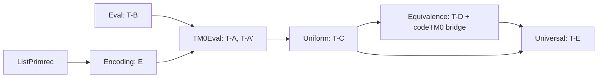

# TuringRecursive — Technical Report

**Result.** A complete, unconditional Lean 4 / Mathlib formalization that the evaluation of a
Post–Turing machine (`Turing.TM0`) is a partial recursive function, uniformly in the machine, together
with the converse Church–Turing equivalence over a fixed alphabet, undecidability of halting, and a
universal machine with a precisely characterized output tape.

- Repository: `/Users/pablosuarez/Desktop/Turing-recursive` (`main` @ `6910013`)
- Lean `v4.36.0`, Mathlib `fc4f59e577feb1a4956671bc04ac18aaaf8cd842` (same pin as S4TuringPoisson)
- 8 Lean files, 2,063 lines, 235 audited declarations, axioms ⊆ {`propext`, `Classical.choice`,
  `Quot.sound`}; no `sorry`, no custom axiom. See `docs/AUDIT.md`.

## 1. Why this exists

Mathlib proves `Partrec ⇒ TM` (`ToPartrec.lean`, `PartrecToTM2`) but not the converse, and has no
`Primcodable` instance on `ListBlank`, `Tape`, or `TM0.Cfg`, so no statement of the form
"`TM0.eval M` is `Partrec`" could even be written. The S4TuringPoisson CMPP track needs the
converse, uniformly in the machine, to build a universal machine as a Hamiltonian flow. This
library supplies exactly that.

## 2. Main theorems (all unconditional; signatures frozen at tag `gate-s1-frozen`)

| Theorem | Statement (informal) | File |
|---|---|---|
| `StateTransition.eval_partrec` | `f : σ → Option σ` computable ⇒ `StateTransition.eval f` partial recursive | `Eval.lean` |
| `StateTransition.eval_partrec₂` | same, uniformly in a parameter `a` | `Eval.lean` |
| `StateTransition.reaches_iff_exists_iterate` | `Reaches f a b ↔ ∃ n, (flip Option.bind f)^[n] (some a) = some b` | `Eval.lean` |
| `Primrec.list_rdropWhile`, `list_dropLast` | right-end list operations are primitive recursive | `ListPrimrec.lean` |
| `ListBlank.trim` (+ `trim_mk`, `mk_trim`, `trim_injective`, `trim_congr`) | canonical blank-free representative of a `ListBlank` | `Encoding.lean` |
| scoped `Primcodable` on `Dir`, `TM0.Stmt`, `ListBlank`, `Tape`, `TM0.Cfg` | Gödel numbering of machine data; `ListBlank` needs only `[Inhabited Γ] [Primcodable Γ]` | `Encoding.lean` |
| `Primrec.listBlank_*`, `Primrec.tape_*` | `mk, trim, head, tail, cons, nth; move, write, mk₁, mk₂, nth, right₀` are primitive recursive | `Encoding.lean` |
| `TM0.step_primrec_of_primrec` | any machine with primitive-recursive table has primitive-recursive step | `TM0Eval.lean` |
| `TM0.step_primrec`, `evalCfg_partrec`, `eval_partrec` | for `[Finite Γ] [Finite Λ]` (no `DecidableEq`/`Fintype`): `TM0.eval M` is `Partrec` | `TM0Eval.lean` |
| `TM0.exists_code_eval` | Kleene form: `∃ c : Nat.Partrec.Code, ∀ l, c.eval (encode l) = (TM0.eval M l).map encode` | `TM0Eval.lean` |
| `TM0Code`, `TM0Code.eval_partrec` | one uniform type of machine codes over ℕ; `(m, c) ↦ eval` is `Partrec₂` | `Uniform.lean` |
| `TM0Code.exists_relabeling` | every finite machine embeds via *injective pointed* maps `f, g` into a `TM0Code`, simulating both `StateTransition.eval` and `TM0.eval` | `Uniform.lean` |
| `nat_partrec_iff_exists_tm0` | `Nat.Partrec f ↔ ∃ finite-state TM0 over the fixed alphabet Γ₀ computing f w.r.t. named encoding encNat` | `Equivalence.lean` |
| `TM0Code.halting_re`, `halting_not_computable` | halting is r.e. and undecidable over `TM0Code × TM0.Cfg ℕ ℕ` | `Universal.lean` |
| `TM0Code.exists_compiler` (`compile`, `eval_compile`, `eval_compile_nat`) | primitive-recursive compiler `TM0Code → Nat.Partrec.Code` | `Universal.lean` |
| `U`, `U_eval`, `U_evalCfg_tape`, `U_mem_evalCfg_iff`, `exists_universal_tm0` | a single finite-state machine `U` over `Γ₀` simulating every `(m, c)`; its halting tape is exactly `Tape.mk₁ (encNat (encode c'))` | `Universal.lean` |

## 3. Architecture

**Key proof ideas.**
1. *T-B is nearly definitional.* `StateTransition.eval f` is a `PFun.fix`, so `Partrec.fix` plus
   `Computable.option_casesOn` suffices. The parametrized version is proved on the product state
   space `α × σ` with `StateTransition.tr_eval`/`tr_eval_rev` (not `tr_eval'`), which keeps `α` and
   `σ` in independent universes.
2. *Quotient encoding via a canonical subtype.* `ListBlank Γ` is a quotient by trailing blanks.
   `trim` strips them; `ListBlank Γ ≃ {l // l.rdropWhile (· == default) = l}`, and `Primcodable`
   is obtained from that subtype. It uses `Encodable.decidableEqOfEncodable` internally, so no
   `DecidableEq` diamond exists. Instances are `scoped` to avoid clashing with a future Mathlib
   instance.
3. *Finite machines need no choice in statements.* Finiteness is `[Finite Γ] [Finite Λ]`; every
   function on a finite domain is primitive recursive (`Primrec.dom_finite`), so `step_primrec`
   holds for any `Primcodable` structure, independent of enumeration.
4. *Relabeling must be injective.* The first draft of T-C (from the directive) allowed
   `f = g = const 0`, `m = ⟨[]⟩`, which satisfies both simulation equations while erasing the machine.
   Adding `Injective f ∧ Injective g` (found at the S1 review, confirmed necessary for CMPP) makes
   the theorem non-trivial; `f`, `g` come from `Fin n` equivalences with `default ↦ 0` via `Equiv.swap`.
5. *T-D (machine side).* Compose Mathlib's `PartrecToTM2.tr_eval`, `TM2to1.tr_respects` and
   `TM1to0.tr_respects`, then restrict the state space to the finite support
   (`restrictSupportedTM0`, preserving the *full* halting tape). We deliberately did **not** use
   `TM2to1.tr_eval`, which forgets that the other three stacks are empty; instead
   `StateTransition.tr_eval` is applied to `tr_respects`, and `TrCfg` pins the output tape to
   `Tape.mk₁ (encNat m)`. The converse uses `TM0.eval_partrec` with a `Primcodable Λ` obtained from
   `Fintype.equivFin`, plus `primrec_encNat`, `primrec_decNat`, and `decNat_encNat`.
6. *Universal machine, no existential decoder.* `encUniv`/`decUniv` are named, computable and fixed;
   `U := codeTM0 univCode` where `univCode` compiles "decode `(m, c)`, run `m` from `c`, encode the
   result" (a `Partrec` function by `TM0Code.eval_partrec`). An existentially quantified decoder
   would let the statement be satisfied by re-running the machine in the decoder; fixing it rules that out.

**Fixed alphabet.** `Γ₀ = TM2to1.Γ' K' (fun _ ↦ Γ')` induced by Mathlib's pipeline: 1,250 symbols
(`2 × 5⁴`), blank `(false, fun _ ↦ none)`; scoped `Fintype K'`, `DecidableEq Γ₀`, `Primcodable Γ₀`
were missing from Mathlib and are provided here.

**Window fact for CMPP.** `encNat 1` is a strict prefix of `encNat 2`, so reading cells `0 … L-1`
does not isolate the output; reading `0 … L` (the blank at cell `L = |encNat c'|` terminates it)
does. This is checked in the audit and fed back into the CMPP refactor plan.

## 4. Deviations from the original directive

| Directive | Delivered | Reason |
|---|---|---|
| T-C relabeling without injectivity | with `Injective f ∧ Injective g` | constant-0 collapse (S1 audit) |
| `Computable.iterate`, `Primrec.dite` as gaps | dropped | not needed once T-B uses `Partrec.fix` (Q5) |
| Existential `(Λ, U)` | defined directly via `codeTM0 univCode`, plain instances (Q4) | avoid `Exists.choose` on `Type` |
| `TM0Code.eval_compile` only | plus `eval_compile_nat` for all `n : ℕ` (Q3) | divergence outside the range of `encode` |
| `ListBlank/Tape` `Primrec` lemmas in `TuringRecursive.*` | `_root_.Primrec.*` (Q2) | uniform dot notation, upstream style |
| Extra instances | `DecidableEq TM0.Stmt`, `Fintype K'`, `DecidableEq`/`Primcodable Γ₀` | absent from Mathlib |
| T-F (TM1/TM2) | not done | deferred by Q4 |

## 5. Process and the local model

Workflow: W0 (local-model infrastructure + calibration) and S0 (read-only Mathlib inventory) →
S1 (statements written with `sorry` on a spec branch, user-reviewed, frozen at tag
`gate-s1-frozen`) → M1…M6, each in an isolated git worktree, each gated by an independent verifier
(G1 build/lint, G2 axioms, G3 statement freeze, G4 wiring, G5 anti-vacuity, G6/G7 faithfulness and
labels, G8 provenance) before merge.

**Calibration (40 already-proved Mathlib lemmas, target and near-duplicates hidden):**

| Tier | N | pass@1 | pass@5 | Routing |
|---|---:|---:|---:|---|
| T0 (unfold/rewrite/projection) | 15 | 4 (26.7%) | 5 (33.3%) | local-first |
| T1 (`Primrec` plumbing) | 15 | 0 | 0 | frontier |
| T2 (core arguments) | 10 | 0 | 0 | frontier |

**In the library:** 45 T0 declarations: 26 accepted by the local model, 19 escalated after five
logged failures (0 gate violations); about 15% of all declarations were produced locally, none of
the headline theorems. The model is useful for boilerplate and not for `Primrec` combinators; the
calibration said so before any milestone relied on it.

**Hardware lesson.** Ollama's MLX runner grew from 7.7 GB to 16 GB across consecutive calls (even at
`num_ctx=4096`), pushing macOS swap to 11 GB on a 24 GB machine. `"keep_alive": 0` (unload after
every call, ~1.4 s reload) held it at 7.7 GB during calls and 0 between, with swap ≤ 3.8 GB.
Because the model is unloaded, Ollama and Lean never coexist in RAM.

## 6. Limitations

- TM0 only; TM1/TM2 evaluation is not proved partrec here (T-F deferred).
- `U` is obtained through Mathlib's `Code.exists_code`/`PartrecToTM2` pipeline: correct and
  finite, but not a human-readable transition table; its state count is not computed. No
  complexity bounds are proved.
- `noncomputable` for `compile`, `univCode`, `U` (choice from `Prop`-valued existence); all
  encodings are computable.
- Instances on `ListBlank`/`Tape`/`Cfg`/`Γ₀` are `scoped`; clients must `open scoped TuringRecursive`.
- Open hygiene findings F-01…F-05 in `docs/AUDIT.md` (license file, provenance artifacts not
  committed, artifact-name collision, absolute paths, doc names). None affects the Lean library.

## 7. Mathlib upstreaming

Natural PR split: (1) `ListPrimrec` + `Eval` (no Turing dependency); (2) `Encoding` + `TM0Eval`;
(3) `Uniform`/`Equivalence`/`Universal` with project names (`Γ₀`, `U`) moved under
`Turing.TM0`/`PartrecToTM2`. Pre-PR polish: F-06.

## 8. Consumers

S4TuringPoisson `MISSION_DIRECTIVE_CMPP.md` track B2/B3 can `require` this package (verified with
a throw-away Lake project). It should consume `TM0Code.eval_partrec`, `exists_relabeling`,
`TM0Code.compile`, `U_evalCfg_tape`/`U_mem_evalCfg_iff`, `default_notMem_encNat`.
